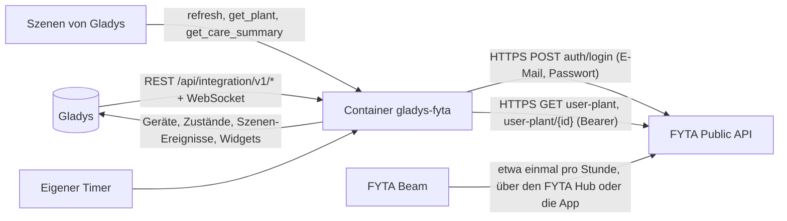
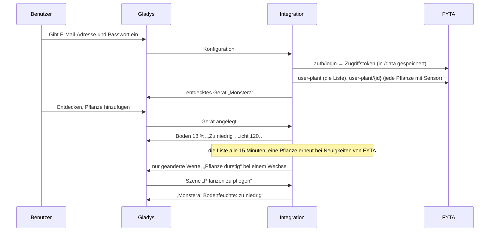
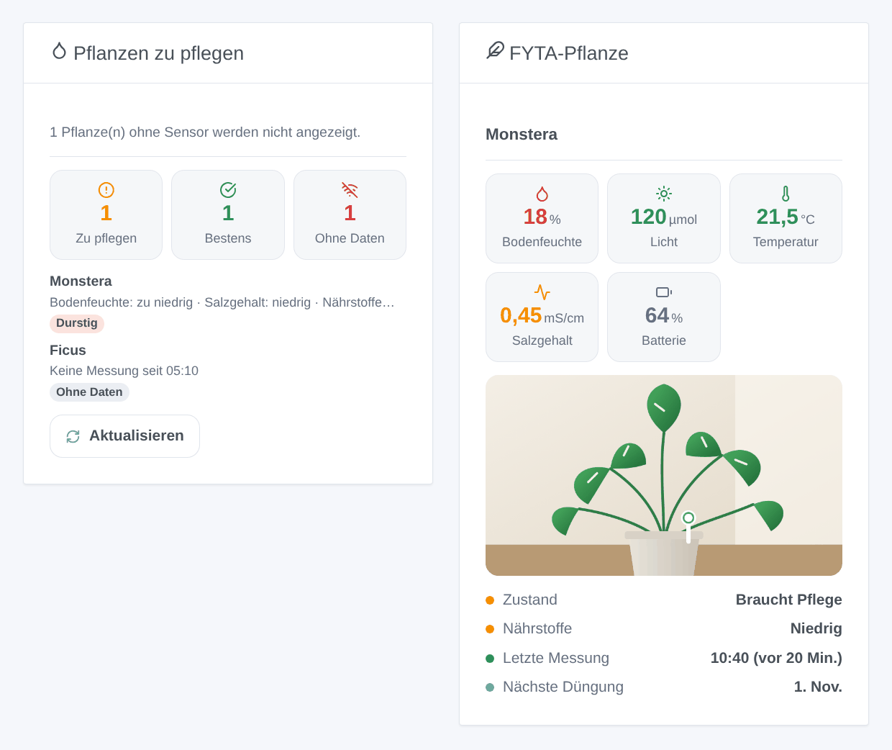

# Gladys FYTA

[English](README.md) · [Français](README.fr.md) · **Deutsch** · [Español](README.es.md)

[](LICENSE)
[](https://github.com/William-De71/gladys-fyta/releases)
[](https://github.com/William-De71/gladys-fyta/actions/workflows/release.yml)
[](https://gladysassistant.com)


Externe Integration für [Gladys Assistant](https://gladysassistant.com) für **FYTA-Beam**-Pflanzensensoren, über die offizielle [FYTA Public API](https://fyta-io.notion.site/FYTA-Public-API-d2f4c30306f74504924c9a40402a3afd) mit der E-Mail-Adresse und dem Passwort deines FYTA-Kontos. Sie zeigt in Gladys Bodenfeuchte, Licht, Temperatur und Batterie jeder Pflanze mit dem Zustand, den FYTA ihnen gibt, und löst Szenen aus, wenn eine Pflanze Durst hat, ein Messwert seinen Bereich verlässt oder zurückkehrt, ein Sensor verstummt oder gedüngt werden sollte — nur lesend.

Benutzerdokumentation: [English](docs/en.md) · [Français](docs/fr.md) · [Deutsch](docs/de.md) · [Español](docs/es.md).

Nicht mit FYTA verbunden. **Noch nicht mit einem echten FYTA-Konto getestet**: Anfragen und Felder folgen der offiziellen Dokumentation und den Feldern, die Home Assistant liest; die Antworten auf ein unbekanntes Konto und ein falsches Token wurden live geprüft.

## Funktionen

- Alle **Pflanzen mit FYTA Beam** des Kontos, von selbst gefunden; die Liste wird standardmäßig alle 15 Minuten in **einer Anfrage** gelesen, die Details einer Pflanze nur, wenn FYTA für sie etwas Neues zeigt.
- **Ein Gerät pro Pflanze**: Bodenfeuchte, Licht (µmol/m²/s), Temperatur, Sensorbatterie und ihr Hinweis auf schwache Batterie, der pH-Wert, wenn FYTA einen liefert, und sechs Zustände, wie FYTA sie liefert (Pflanze, Bodenfeuchte, Licht, Temperatur, Salzgehalt, Nährstoffe: zu niedrig, niedrig, perfekt, hoch, zu hoch).
- **9 Szenen-Auslöser** (Pflanze braucht Pflege, Pflanze durstig, Messwert außerhalb des Bereichs, Messwert wieder im Bereich, Sensorbatterie schwach, Sensor stumm, Sensor wieder da, Düngung fällig, Zugriff verweigert), **3 Szenen-Aktionen** (jetzt aktualisieren, Werte einer Pflanze, Pflanzen zu pflegen) und **2 Dashboard-Widgets** (Pflanzen zu pflegen, eine Pflanze mit Foto).
- **Nur lesend**: eine Anmeldung, dann nur `GET`-Anfragen; im FYTA-Konto wird nie etwas geändert.
- Das Zugriffstoken von FYTA wird in `/data` gespeichert, bis es abläuft (keine Anmeldung bei jedem Neustart); das Passwort wird dort nie gespeichert.
- Vier Sprachen überall: Englisch, Französisch, Deutsch, Spanisch.

## Funktionsweise




Vom Konto zur Szene:



### Transport

`transports: ["cloud"]`: Alles läuft über die FYTA-Cloud (`web.fyta.de`), die die Messwerte der Beams über den FYTA Hub oder die FYTA-App erhält. **E-Mail-Adresse und Passwort verlassen dein Netzwerk** (nur zu FYTA, zur Anmeldung); die Messwerte deiner Pflanzen kommen von FYTA. `/data` speichert das Zugriffstoken und seinen Ablauf, einen Fingerabdruck der E-Mail-Adresse, die Pflanzen und ihre letzten Details sowie das, was die Auslöser wissen — nie das Passwort.

## Geräte und Funktionen

| Gerät                     | Funktionen (Kategorie / Typ)                                                                                                                                                                                                                                                                                                                                                                                                             |
| ------------------------- | ---------------------------------------------------------------------------------------------------------------------------------------------------------------------------------------------------------------------------------------------------------------------------------------------------------------------------------------------------------------------------------------------------------------------------------------- |
| Eins pro Pflanze mit Beam | Bodenfeuchte (`soil-moisture-sensor` / `decimal`, %), Licht (`light-sensor` / `decimal`, µmol/m²/s, ohne Einheit in Gladys), Temperatur (`temperature-sensor` / `decimal`, °C), pH (`ph-sensor` / `decimal`, wenn FYTA einen liefert), Sensorbatterie (`battery` / `integer`, %), Sensorbatterie schwach (`battery-low` / `binary`), Zustände von Pflanze, Bodenfeuchte, Licht, Temperatur, Salzgehalt und Nährstoffen (`text` / `text`) |

- FYTA misst das Licht als Photonenfluss (PPFD, µmol/m²/s), nicht in Lux: Der Kern hat dafür keine Einheit, also hat die Funktion keine und ihr Name sagt es.
- Der Salzgehalt (elektrische Leitfähigkeit des Bodens, der Dünger, mS/cm) hat im Kern keine Kategorie: Sein Zustand ist eine Funktion, sein Wert wird vom Widget angezeigt und an die Szenen gegeben.
- Die Zustände sind Texte in der Sprache der Konfiguration („Zu niedrig“, „Perfekt“…), so wie FYTA jeden Messwert nach den Bedürfnissen der Art bewertet.
- Eine Pflanze ohne Sensor wird nicht angeboten. Die externen IDs beruhen auf der ID der Pflanze im FYTA-Konto (`ext:fyta:plant:<id>`).
- Unveränderte Werte eines Sensors, der noch sendet, werden alle 6 Stunden erneut gesendet, damit Gladys sie nicht als veraltet anzeigt; die eines stummen Sensors altern.

## Szenen-Auslöser, Aktionen und Widgets



**Widgets**: Pflanzen zu pflegen (wie viele Pflege brauchen, bestens dastehen, keine Daten senden; die Pflanzen, um die du dich kümmern solltest, die dringendsten zuerst, mit dem, was nicht stimmt, und per Tippen die Werte und ihr idealer Bereich; eine Schaltfläche Aktualisieren) und FYTA-Pflanze (das Foto aus der FYTA-App, Bodenfeuchte, Licht, Temperatur, Salzgehalt und Batterie nach Zustand gefärbt, der Zustand der Pflanze und ihrer Nährstoffe, die letzte Messung, das nächste Düngedatum).

**Auslöser** (ein Ereignis pro Wechsel, nie bei der ersten Abfrage, nie als Folge einer Aktion):

- **Pflanze braucht Pflege**: Der FYTA-Zustand der Pflanze wechselt von „alles bestens“ zu „braucht Pflege“; Variablen: was nicht stimmt, wie viele Messwerte;
- **Pflanze durstig**: Die Bodenfeuchte fällt in den niedrigen oder zu niedrigen Bereich; Variablen: die Feuchte, die Stufe, die kleinste ideale Feuchte;
- **Messwert außerhalb des Bereichs** / **wieder im Bereich**: Bodenfeuchte, Licht, Temperatur, Salzgehalt oder Nährstoffe wechseln die Stufe (Filter: Messwerte, Stufen); Variablen: der Wert, seine Einheit, der ideale Bereich;
- **Sensorbatterie schwach**: FYTA meldet die Batterie;
- **Sensor stumm** / **Sensor wieder da**: kein Messwert während der eingestellten Zeit (standardmäßig 3 Std.), dann wieder Messwerte, mit der Dauer der Pause;
- **Düngung fällig**: das von FYTA geplante Datum, um 9:00 Uhr;
- **Zugriff verweigert**: FYTA lehnt E-Mail-Adresse, Passwort oder Konto ab — einmal pro Ablehnung.

Filter: die Pflanze. Die Werte (Bodenfeuchte, Temperatur) sind Gerätefunktionen: „Bodenfeuchte unter 30 %“ ist ein Geräte-Auslöser von Gladys.

**Aktionen**:

- **jetzt aktualisieren**: liest sofort alle Pflanzen (höchstens einmal pro Minute); die Auslöser folgen in der nächsten Runde des Timers, nie aus der Aktion.
- **Werte einer Pflanze**: Bodenfeuchte, Licht, Temperatur, Salzgehalt, Batterie, ihre Zustände, die Stunden seit der letzten Messung und ein Satz, aus der letzten Abfrage (ohne Anfrage).
- **Pflanzen zu pflegen**: wie viele Pflanzen Pflege brauchen, wie viele Sensoren stumm sind, und ein Satz, der sie aufzählt — für eine tägliche Nachricht.

Bewusst nicht umgesetzt: kein Schreiben (die öffentliche API bietet keins), kein Verlaufsdiagramm (den Endpunkt der Messwerte gibt es, aber die Gerätefunktionen speichern den Verlauf bereits in Gladys), keine Schaltfläche „gegossen“ (FYTA hat dafür keinen Endpunkt).

Beispiele:

- Wenn **FYTA: Pflanze durstig** → sende „{{triggerEvent.data.plant_name}} hat Durst ({{triggerEvent.data.moisture}} %)“.
- Jeden Tag um 8:00 Uhr → **FYTA: Pflanzen zu pflegen**; wenn die Zahl größer als 0 ist → sende die Zusammenfassung.
- Wenn **FYTA: Sensor stumm** → sende „Keine Nachricht von {{triggerEvent.data.plant_name}} seit {{triggerEvent.data.hours_without_data}} Std.“.

## Voraussetzungen

- Gladys Assistant **5.3.0** oder neuer (Widgets und Szenen von Integrationen, Katalog-Schlagwörter von Gladys 5.3): Ältere Instanzen können die Integration nicht installieren.
- Ein FYTA-Konto mit mindestens einer Pflanze mit **FYTA Beam**, dessen Messwerte über einen **FYTA Hub** (oder die FYTA-App, wenn das Telefon in der Nähe ist) in die FYTA-Cloud gelangen.
- Internet: Die Integration spricht nur mit `web.fyta.de` (und mit dem Host der Pflanzenfotos, die FYTA liefert, ohne das Token, außer er liegt auf `fyta.de`).

### Das Tempo der API

FYTA dokumentiert kein Kontingent. Die Integration bleibt sparsam: eine Anfrage nach der anderen, mindestens eine Sekunde Abstand; die Liste der Pflanzen standardmäßig alle 15 Minuten (eine Anfrage für das ganze Konto), die Details einer Pflanze nur, wenn die Liste für sie einen neuen Messwert, Zustand oder Batteriehinweis zeigt, oder alle 6 Stunden; eine Anmeldung alle 60 Tage. Nach einem 429 wartet jede Anfrage ihr Retry-After ab (30 Sekunden bis eine Stunde). Ein Beam sendet etwa einmal pro Stunde: Häufiger zu lesen brächte nichts.

## Installation

- **Aus dem Store**: Integrationen → FYTA → Installieren.
- **Über die URL des Repositorys**: Integrationen → externe Integration → `https://github.com/William-De71/gladys-fyta`.
- **Entwicklermodus**: Starte `npm start` mit den Variablen, die Gladys liefert (siehe Entwicklung).

## Konfiguration

| Feld oder Schaltfläche       | Standard    | Bedeutung                                                                                    |
| ---------------------------- | ----------- | -------------------------------------------------------------------------------------------- |
| E-Mail-Adresse               | —           | Pflicht: die E-Mail des FYTA-Kontos                                                          |
| Passwort                     | —           | Pflicht, ein Geheimnis: nie wieder angezeigt, nie geloggt, nie nach `/data` geschrieben      |
| Abfrage der Pflanzen         | 15 Min.     | 10, 15, 30 oder 60 Min.: eine Anfrage für die Liste des Kontos                               |
| Sensor ohne Daten nach       | 3 Std.      | 2, 3, 6, 12 oder 24 Std. ohne neuen Messwert                                                 |
| Sprache der Texte            | automatisch | Namen der Funktionen, Zustände, Szenentexte und Fehler                                       |
| Verbindung testen / Diagnose | —           | Eine Anmeldung und die Pflanzen mit Sensor; der Zustand in den Logs, ohne Passwort und Token |

## Verwendung

1. In Gladys (Integrationen → FYTA → Konfiguration): Gib E-Mail-Adresse und Passwort der FYTA-App ein; drücke **Verbindung testen**.
2. **Entdecken**, dann füge deine Pflanzen als Geräte hinzu.
3. Füge die Widgets einem Dashboard hinzu.
4. Baue Szenen mit den Funktionen, den Auslösern und den Aktionen.

## Entwicklung

```bash
npm install
npm test                       # node --test, ein falsches FYTA (fetch im Speicher), nie das Netzwerk
npm run lint                   # ESLint
npm run format:check           # Prettier
npx github:GladysAssistant/integration-store . --skip-image-check
scripts/build-cover.sh         # cover.jpg aus docs/assets/cover.svg
docs/illustrations/render.sh   # docs/assets/widgets.<lang>.png
```

Lokal liest das SDK `GLADYS_HOST_API_URL`, `GLADYS_INTEGRATION_TOKEN` und `GLADYS_INTEGRATION_SELECTOR` (von Gladys im Entwicklermodus geliefert), und die Integration liest `TZ`. `DEBUG=gladys-integration-sdk` zeigt die Logs des SDK.

Die Tests decken den HTTP-Client ab (die Anmeldung, 404 / 401 bei der Anmeldung, 403 und 500 bei einem Token, eine neue Anmeldung, 429 und Retry-After, eine Anfrage nach der anderen, die Fotos), die Parser (die Beispiele der offiziellen Dokumentation, unverändert in `test/fixtures/fyta-doc.json`, und ein erfundenes Konto in ihrer Form), die Auslöser (Wechsel, Stille, Düngung), die Geräte (die Felder, die der Entdecken-Bildschirm verlangt, die Kategorie-/Typ-Paare des Kerns), die Widgets (`validateWidgetContent`), das Manifest, die vier Sprachen, das Release-Skript und die ganze Integration gegen das falsche Gladys des SDK und ein falsches FYTA. `test/structure.test.js` friert alle Schlüssel ein, die Benutzer speichern.

## Release-Prozess


Jeder Merge auf `main` startet die CI und berechnet dann die Version aus den [Conventional Commits](https://www.conventionalcommits.org/) seit dem letzten Tag: `feat` → Minor, `fix` / `perf` → Patch, `!` oder `BREAKING CHANGE` → Major (unter 1.0.0 ein Minor); `docs`, `chore`, `ci`, `test`, `style`, `refactor`, `build` allein veröffentlichen nichts. Der Changelog-Abschnitt wird erzeugt, der Tag gepusht, das Multi-Architektur-Image gebaut, dann erhält `main` den Release-Commit, das GitHub-Release wird erstellt und ein letzter Job prüft das öffentliche Image, den Store-Validator und das Topic.

- Der Titel des Pull Requests wird zum Squash-Commit, dann zur Changelog-Zeile: schreibe ihn auf Englisch, für den Benutzer (`pr-title.yml` prüft ihn). Bearbeite `CHANGELOG.md` nie von Hand.
- 1.0.0 ist eine Entscheidung: Actions → Release → Run workflow mit `release-as: 1.0.0`. `dry-run` zeigt Version und Notizen, ohne zu veröffentlichen.
- **Geschützter Branch**: Das Release pusht seinen Commit mit `GITHUB_TOKEN` auf `main`. Das Ruleset `protect-main` (kein Löschen, kein Force-Push) lässt ihn durch; eine strengere Regel (Pull Request Pflicht, Status-Checks) bräuchte GitHub Actions in ihrer Bypass-Liste oder eine GitHub App.
- Mache nach dem ersten Release das Paket auf `ghcr.io` öffentlich (Package settings → Change visibility), sonst kann Gladys es nicht laden.

## Fehlerbehebung

Siehe [docs/de.md](docs/de.md#fehlerbehebung). Melde Probleme mit den Versionen von Gladys und der Integration, wie der Beam sendet (FYTA Hub oder App), der Meldung von **Verbindung testen** und dem Ergebnis von **Diagnose** (in den Logs der Integration). Füge nie dein Passwort ein.

## Mitwirken

Issues und Pull Requests sind willkommen. Führe `npm run format:check && npm run lint && npm test` aus, bevor du einen Pull Request öffnest, und lass alle externen IDs und gespeicherten Schlüssel unverändert (siehe [CLAUDE.md](CLAUDE.md)).

## Sicherheit

Siehe [SECURITY.md](SECURITY.md): Melde Schwachstellen vertraulich. Das Passwort ist ein `secret`-Feld: nie geloggt, nie nach `/data` geschrieben, nur zur Anmeldung an `web.fyta.de` gesendet. Das Zugriffstoken von FYTA wird bis zu seinem Ablauf in `/data/fyta.json` (Modus 0600) gespeichert, nie geloggt und nur an `fyta.de`-Hosts gesendet.

## Kommende Screenshots

Die Bilder oben sind Illustrationen, keine Screenshots. Echte Screenshots kommen nach `docs/assets/screenshots/` (PNG, 1280 × 800): `configuration.png`, `discovery.png` (die angebotenen Pflanzen), `device.png` (eine Pflanze mit ihren Funktionen), `scene-thirsty.png` (eine Szene mit dem Auslöser „Pflanze durstig“), `dashboard.png` (die zwei Widgets mit echten Pflanzen und Fotos).

## Lizenz

[Apache License 2.0](LICENSE) — siehe auch [NOTICE](NOTICE). FYTA und FYTA Beam sind Marken ihres Inhabers. Dank an die Dokumentation und das SDK von Gladys, an FYTA für die Dokumentation seiner öffentlichen API und an die Autoren der Home-Assistant-Integration „FYTA“ und ihrer Bibliothek fyta_cli.
