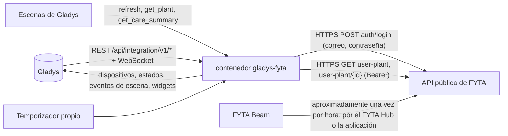
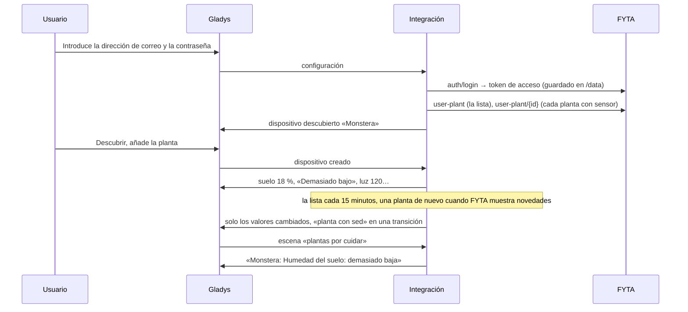
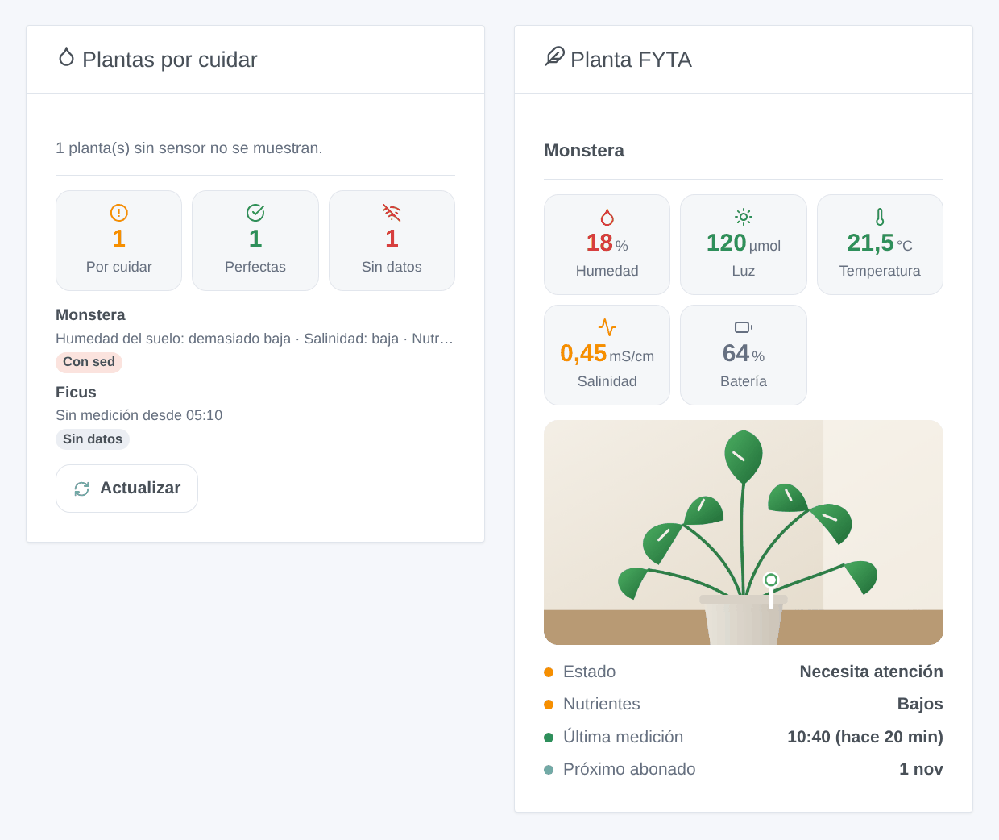

# Gladys FYTA

[English](README.md) · [Français](README.fr.md) · [Deutsch](README.de.md) · **Español**

[](LICENSE)
[](https://github.com/William-De71/gladys-fyta/releases)
[](https://github.com/William-De71/gladys-fyta/actions/workflows/release.yml)
[](https://gladysassistant.com)


Integración externa de [Gladys Assistant](https://gladysassistant.com) para los sensores de plantas **FYTA Beam**, mediante la [API pública oficial de FYTA](https://fyta-io.notion.site/FYTA-Public-API-d2f4c30306f74504924c9a40402a3afd) con la dirección de correo y la contraseña de su cuenta FYTA. Muestra en Gladys la humedad del suelo, la luz, la temperatura y la batería de cada planta con el estado que FYTA les da, y lanza escenas cuando una planta tiene sed, una medida sale de su rango o vuelve a él, un sensor deja de enviar datos o toca abonar — solo lectura.

Documentación de usuario: [English](docs/en.md) · [Français](docs/fr.md) · [Deutsch](docs/de.md) · [Español](docs/es.md).

No afiliada a FYTA. **Aún no probada con una cuenta FYTA real**: las peticiones y los campos siguen la documentación oficial y los campos que lee Home Assistant; las respuestas a una cuenta desconocida y a un token falso se comprobaron en real.

## Funciones

- Todas las **plantas con un FYTA Beam** de la cuenta, encontradas solas; la lista leída en **una petición** cada 15 minutos por defecto, el detalle de una planta solo cuando FYTA muestra algo nuevo para ella.
- **Un dispositivo por planta**: humedad del suelo, luz (µmol/m²/s), temperatura, batería del sensor y su indicador de batería baja, el pH cuando FYTA lo da, y seis estados tal como los da FYTA (planta, humedad del suelo, luz, temperatura, salinidad, nutrientes: demasiado bajo, bajo, perfecto, alto, demasiado alto).
- **9 disparadores de escena** (planta necesita atención, planta con sed, medida fuera de rango, medida de nuevo en rango, batería del sensor baja, sensor sin señal, sensor de vuelta, toca abonar, acceso rechazado), **3 acciones de escena** (actualizar ahora, valores de una planta, plantas por cuidar) y **2 widgets del panel** (plantas por cuidar, una planta con su foto).
- **Solo lectura**: un inicio de sesión y luego solo peticiones `GET`; nunca se cambia nada en la cuenta FYTA.
- El token de acceso de FYTA se guarda en `/data` hasta que caduca (sin inicio de sesión en cada reinicio); la contraseña nunca se escribe ahí.
- Cuatro idiomas en todas partes: inglés, francés, alemán, español.

## Cómo funciona




De la cuenta a una escena:



### Transporte

`transports: ["cloud"]`: todo pasa por la nube de FYTA (`web.fyta.de`), que recibe las mediciones de los Beam a través del FYTA Hub o de la aplicación FYTA. **La dirección de correo y la contraseña salen de su red** (solo hacia FYTA, para iniciar sesión); las mediciones de sus plantas vienen de FYTA. `/data` guarda el token de acceso y su caducidad, una huella de la dirección de correo, las plantas y su último detalle, y lo que saben los disparadores — nunca la contraseña.

## Dispositivos y funciones

| Dispositivo                | Funciones (categoría / tipo)                                                                                                                                                                                                                                                                                                                                                                                                                              |
| -------------------------- | --------------------------------------------------------------------------------------------------------------------------------------------------------------------------------------------------------------------------------------------------------------------------------------------------------------------------------------------------------------------------------------------------------------------------------------------------------- |
| Uno por planta con un Beam | Humedad del suelo (`soil-moisture-sensor` / `decimal`, %), luz (`light-sensor` / `decimal`, µmol/m²/s, sin unidad en Gladys), temperatura (`temperature-sensor` / `decimal`, °C), pH (`ph-sensor` / `decimal`, cuando FYTA lo da), batería del sensor (`battery` / `integer`, %), batería del sensor baja (`battery-low` / `binary`), estados de la planta, la humedad del suelo, la luz, la temperatura, la salinidad y los nutrientes (`text` / `text`) |

- FYTA mide la luz como un flujo de fotones (PPFD, µmol/m²/s), no en lux: el núcleo no tiene unidad para ello, así que la función no tiene y su nombre lo indica.
- La salinidad (conductividad eléctrica del suelo, el abono, mS/cm) no tiene categoría en el núcleo: su estado es una función, su valor lo muestra el widget y se da a las escenas.
- Los estados son textos en el idioma de la configuración («Demasiado bajo», «Perfecto»…), tal como FYTA evalúa cada medida según las necesidades de la especie.
- Una planta sin sensor no se ofrece. Los identificadores externos se basan en el id de la planta en la cuenta FYTA (`ext:fyta:plant:<id>`).
- Los valores sin cambios de un sensor que sigue enviando se vuelven a enviar cada 6 horas, para que Gladys no los muestre como obsoletos; los de un sensor sin señal envejecen.

## Disparadores, acciones de escena y widgets



**Widgets**: Plantas por cuidar (cuántas necesitan cuidados, están perfectas, no envían datos; las plantas por cuidar, las peores primero, con lo que falla y, al tocar, los valores y su rango ideal; un botón Actualizar) y Planta FYTA (la foto de la aplicación FYTA, la humedad del suelo, la luz, la temperatura, la salinidad y la batería coloreadas según su estado, el estado de la planta y de sus nutrientes, la última medición, la fecha del próximo abonado).

**Disparadores** (un evento por transición, nunca en la primera lectura, nunca como resultado de una acción):

- **planta necesita atención**: el estado FYTA de la planta pasa de «en perfecto estado» a «necesita atención»; variables: qué falla, cuántas medidas;
- **planta con sed**: la humedad del suelo entra en el rango bajo o demasiado bajo; variables: la humedad, el nivel, la humedad ideal mínima;
- **medida fuera de rango** / **de nuevo en rango**: la humedad del suelo, la luz, la temperatura, la salinidad o los nutrientes cambian de nivel (filtros: medidas, niveles); variables: el valor, su unidad, el rango ideal;
- **batería del sensor baja**: FYTA marca la batería;
- **sensor sin señal** / **sensor de vuelta**: ninguna medición durante el plazo de la configuración (3 h por defecto), luego mediciones de nuevo, con la duración del silencio;
- **toca abonar**: la fecha prevista por FYTA, a las 9:00;
- **acceso rechazado**: FYTA rechaza la dirección de correo, la contraseña o la cuenta — una vez por rechazo.

Filtro: la planta. Los valores (humedad del suelo, temperatura) son funciones del dispositivo: «humedad del suelo por debajo del 30 %» es un disparador de dispositivo de Gladys.

**Acciones**:

- **actualizar ahora**: lee todas las plantas en ese momento (como mucho una vez por minuto); los disparadores siguen en la próxima ronda del temporizador, nunca desde la acción.
- **valores de una planta**: humedad del suelo, luz, temperatura, salinidad, batería, sus estados, las horas desde la última medición y una frase, según la última lectura (sin petición).
- **plantas por cuidar**: cuántas plantas necesitan cuidados, cuántos sensores no tienen señal, y una frase que las enumera — para un mensaje diario.

No hecho, a propósito: ninguna escritura (la API pública no la ofrece), ningún gráfico de historial (el endpoint de mediciones existe, pero las funciones del dispositivo ya guardan el historial en Gladys), ningún botón «regado» (FYTA no tiene endpoint para ello).

Ejemplos:

- Cuando **FYTA: planta con sed** → enviar «{{triggerEvent.data.plant_name}} tiene sed ({{triggerEvent.data.moisture}} %)».
- Cada día a las 8:00 → **FYTA: plantas por cuidar**; si el número es mayor que 0 → enviar su resumen.
- Cuando **FYTA: sensor sin señal** → enviar «Sin noticias de {{triggerEvent.data.plant_name}} desde hace {{triggerEvent.data.hours_without_data}} h».

## Requisitos

- Gladys Assistant **5.1.0** o posterior (widgets y escenas de las integraciones): las instancias más antiguas no pueden instalar la integración.
- Una cuenta FYTA con al menos una planta asociada a un **FYTA Beam**, cuyas mediciones llegan a la nube de FYTA a través de un **FYTA Hub** (o de la aplicación FYTA cuando el teléfono está cerca).
- Internet: la integración solo habla con `web.fyta.de` (y con el host de las fotos de plantas que da FYTA, sin el token salvo que esté en `fyta.de`).

### El ritmo de la API

FYTA no documenta ninguna cuota. La integración se mantiene ligera: una petición cada vez, separadas al menos un segundo; la lista de plantas cada 15 minutos por defecto (una petición para toda la cuenta), el detalle de una planta solo cuando la lista muestra para ella una nueva medición, un nuevo estado o un indicador de batería, o cada 6 horas; un inicio de sesión cada 60 días. Tras un 429, cada petición espera su Retry-After (de 30 segundos a una hora). Un Beam envía aproximadamente una vez por hora: leer más a menudo no aportaría nada.

## Instalación

- **Desde la tienda**: Integraciones → FYTA → Instalar.
- **Desde la URL del repositorio**: Integraciones → integración externa → `https://github.com/William-De71/gladys-fyta`.
- **Modo desarrollador**: ejecute `npm start` con las variables que da Gladys (vea Desarrollo).

## Configuración

| Campo o botón                    | Por defecto | Significado                                                                                        |
| -------------------------------- | ----------- | -------------------------------------------------------------------------------------------------- |
| Dirección de correo              | —           | Obligatorio: el correo de la cuenta FYTA                                                           |
| Contraseña                       | —           | Obligatorio, un secreto: nunca se vuelve a mostrar, nunca se registra, nunca se escribe en `/data` |
| Lectura de las plantas           | 15 min      | 10, 15, 30 o 60 min: una petición para la lista de la cuenta                                       |
| Sensor sin datos después de      | 3 h         | 2, 3, 6, 12 o 24 h sin una nueva medición                                                          |
| Idioma de los textos             | automático  | Nombres de las funciones, estados, textos de escenas y errores                                     |
| Probar la conexión / Diagnóstico | —           | Un inicio de sesión y las plantas con sensor; el estado en los registros, sin contraseña ni token  |

## Uso

1. En Gladys (Integraciones → FYTA → Configuración): introduzca la dirección de correo y la contraseña de la aplicación FYTA; pulse **Probar la conexión**.
2. **Descubrir**, luego añada sus plantas como dispositivos.
3. Añada los widgets a un panel.
4. Cree escenas con las funciones, los disparadores y las acciones.

## Desarrollo

```bash
npm install
npm test                       # node --test, un FYTA falso (fetch en memoria), nunca la red
npm run lint                   # ESLint
npm run format:check           # Prettier
npx github:GladysAssistant/integration-store . --skip-image-check
scripts/build-cover.sh         # cover.jpg desde docs/assets/cover.svg
docs/illustrations/render.sh   # docs/assets/widgets.<lang>.png
```

En local, el SDK lee `GLADYS_HOST_API_URL`, `GLADYS_INTEGRATION_TOKEN` y `GLADYS_INTEGRATION_SELECTOR` (dados por Gladys en modo desarrollador), y la integración lee `TZ`. `DEBUG=gladys-integration-sdk` muestra los registros del SDK.

Las pruebas cubren el cliente HTTP (el inicio de sesión, 404 / 401 al iniciar sesión, 403 y 500 con un token, un nuevo inicio de sesión, 429 y Retry-After, una petición cada vez, las fotos), los analizadores (los ejemplos de la documentación oficial, guardados sin cambios en `test/fixtures/fyta-doc.json`, y una cuenta inventada con sus formas), los disparadores (transiciones, silencio, abonado), los dispositivos (los campos que exige la pantalla de descubrimiento, los pares categoría / tipo del núcleo), los widgets (`validateWidgetContent`), el manifiesto, los cuatro idiomas, el script de release y toda la integración frente al Gladys falso del SDK y un FYTA falso. `test/structure.test.js` congela todas las claves que guardan los usuarios.

## Proceso de release


Cada fusión en `main` ejecuta la CI y luego calcula la versión a partir de los [Conventional Commits](https://www.conventionalcommits.org/) desde la última etiqueta: `feat` → menor, `fix` / `perf` → parche, `!` o `BREAKING CHANGE` → mayor (una menor por debajo de 1.0.0); `docs`, `chore`, `ci`, `test`, `style`, `refactor`, `build` solos no publican nada. Se genera la sección del changelog, se envía la etiqueta, se construye la imagen multiarquitectura, luego `main` recibe el commit de release, se crea la GitHub Release y un último job comprueba la imagen pública, el validador de la tienda y el topic.

- El título de la pull request se convierte en el commit squash y luego en la línea del changelog: escríbalo en inglés, para el usuario (`pr-title.yml` lo comprueba). No edite nunca `CHANGELOG.md` a mano.
- 1.0.0 es una decisión: Actions → Release → Run workflow con `release-as: 1.0.0`. `dry-run` muestra la versión y las notas sin publicar.
- **Rama protegida**: la release envía su commit a `main` con `GITHUB_TOKEN`. El ruleset `protect-main` (sin borrado ni force-push) lo deja pasar; una regla más estricta (pull request obligatoria, status checks) necesitaría GitHub Actions en su lista de exclusión, o una GitHub App.
- Tras la primera release, haga público el paquete de `ghcr.io` (Package settings → Change visibility), o Gladys no podrá descargarlo.

## Solución de problemas

Vea [docs/es.md](docs/es.md#solución-de-problemas). Informe de los problemas con las versiones de Gladys y de la integración, cómo envía el Beam (FYTA Hub o aplicación), el mensaje de **Probar la conexión** y el resultado de **Diagnóstico** (en los registros de la integración). No pegue nunca su contraseña.

## Contribuir

Las issues y pull requests son bienvenidas. Ejecute `npm run format:check && npm run lint && npm test` antes de abrir una pull request, y mantenga sin cambios todos los identificadores externos y claves guardadas (vea [CLAUDE.md](CLAUDE.md)).

## Seguridad

Vea [SECURITY.md](SECURITY.md): informe de las vulnerabilidades en privado. La contraseña es un campo `secret`: nunca se registra, nunca se escribe en `/data`, solo se envía a `web.fyta.de` para iniciar sesión. El token de acceso que da FYTA se guarda en `/data/fyta.json` (modo 0600) hasta que caduca, nunca se registra y solo se envía a hosts `fyta.de`.

## Capturas pendientes

Las imágenes anteriores son ilustraciones, no capturas de pantalla. Las capturas reales irán en `docs/assets/screenshots/` (PNG, 1280 × 800): `configuration.png`, `discovery.png` (las plantas ofrecidas), `device.png` (una planta con sus funciones), `scene-thirsty.png` (una escena con el disparador «planta con sed»), `dashboard.png` (los dos widgets con plantas y fotos reales).

## Licencia

[Apache License 2.0](LICENSE) — vea también [NOTICE](NOTICE). FYTA y FYTA Beam son marcas de su propietario. Gracias a la documentación y al SDK de Gladys, a FYTA por la documentación de su API pública, y a los autores de la integración «FYTA» de Home Assistant y de su biblioteca fyta_cli.
