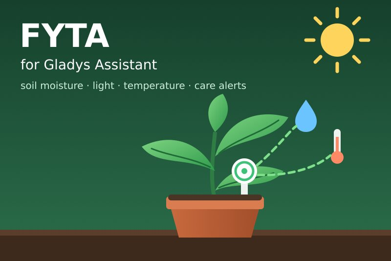
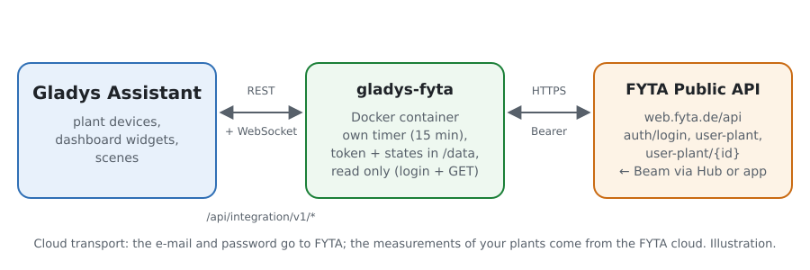
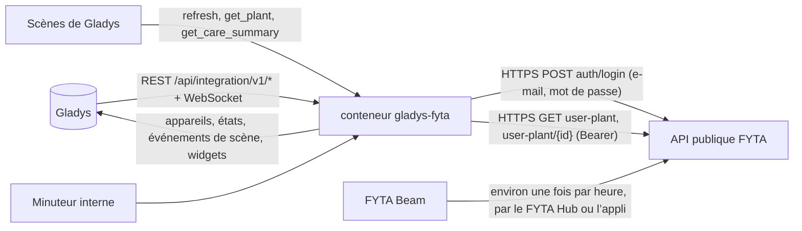
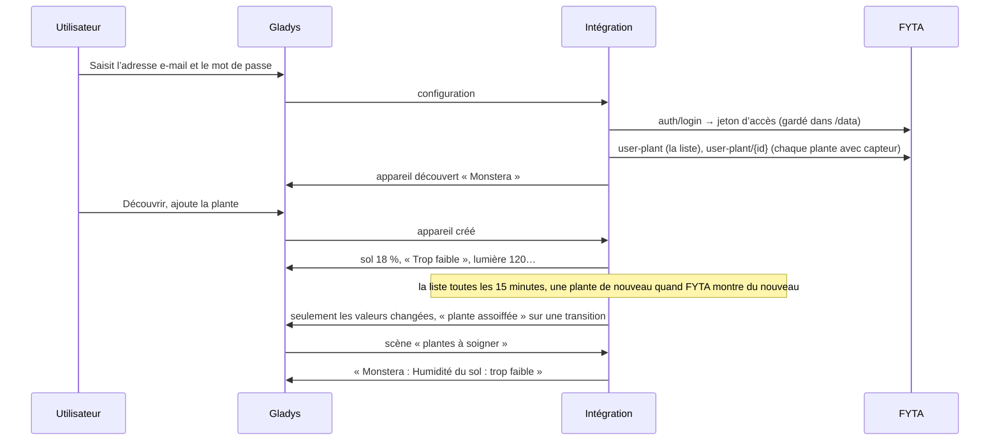
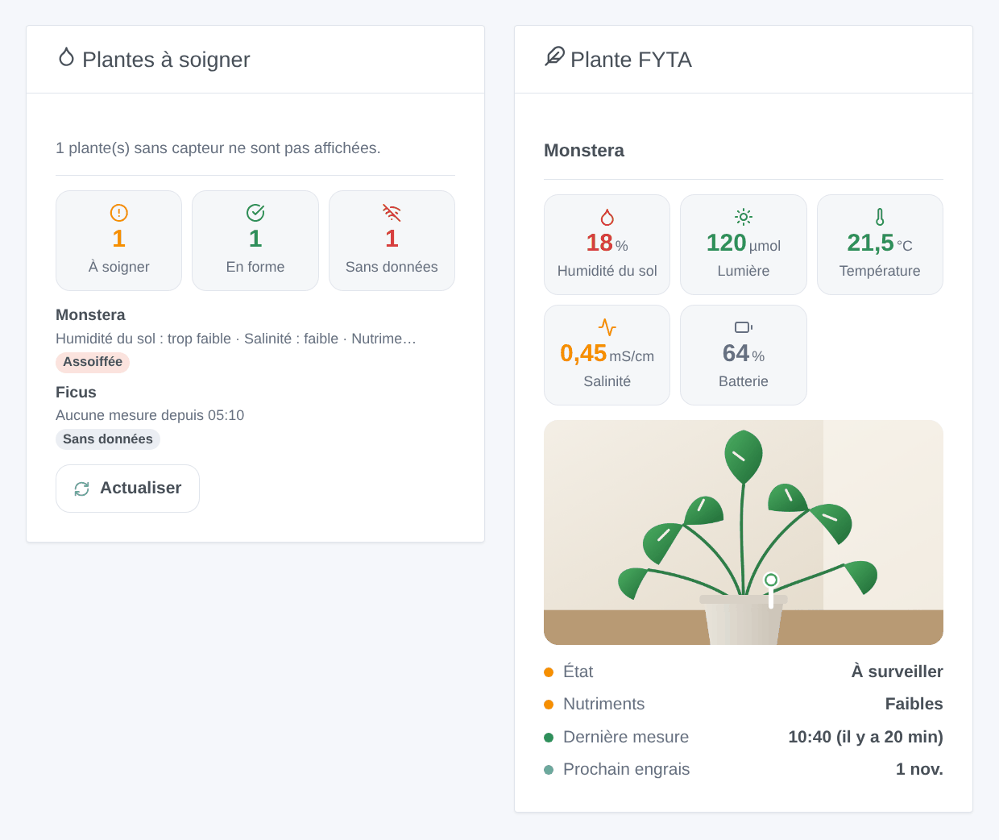

# Gladys FYTA

[English](README.md) · **Français** · [Deutsch](README.de.md) · [Español](README.es.md)

[](LICENSE)
[](https://github.com/William-De71/gladys-fyta/releases)
[](https://github.com/William-De71/gladys-fyta/actions/workflows/release.yml)
[](https://gladysassistant.com)



Intégration externe de [Gladys Assistant](https://gladysassistant.com) pour les capteurs de plantes **FYTA Beam**, par l’[API publique officielle de FYTA](https://fyta-io.notion.site/FYTA-Public-API-d2f4c30306f74504924c9a40402a3afd) avec l’adresse e-mail et le mot de passe de votre compte FYTA. Elle affiche dans Gladys l’humidité du sol, la lumière, la température et la batterie de chaque plante avec l’état que FYTA leur donne, et déclenche des scènes quand une plante a soif, qu’une mesure sort de sa plage ou y revient, qu’un capteur se tait ou qu’il est temps de mettre de l’engrais — en lecture seule.

Documentation utilisateur : [English](docs/en.md) · [Français](docs/fr.md) · [Deutsch](docs/de.md) · [Español](docs/es.md).

Non affiliée à FYTA. **Pas encore testée avec un vrai compte FYTA** : les requêtes et les champs suivent la documentation officielle et les champs que lit Home Assistant ; les réponses à un compte inconnu et à un jeton faux ont été vérifiées en réel.

## Fonctionnalités

- Toutes les **plantes équipées d’un FYTA Beam** du compte, trouvées seules ; la liste lue en **une requête** toutes les 15 minutes par défaut, le détail d’une plante seulement quand FYTA montre du nouveau pour elle.
- **Un appareil par plante** : humidité du sol, lumière (µmol/m²/s), température, batterie du capteur et son indicateur de batterie faible, le pH quand FYTA en donne un, et six états tels que FYTA les donne (plante, humidité du sol, lumière, température, salinité, nutriments : trop faible, faible, parfait, élevé, trop élevé).
- **9 déclencheurs de scène** (plante à surveiller, plante assoiffée, mesure hors plage, mesure revenue dans la plage, batterie du capteur faible, capteur muet, capteur de retour, engrais à apporter, accès refusé), **3 actions de scène** (actualiser maintenant, valeurs d’une plante, plantes à soigner) et **2 widgets** (plantes à soigner, une plante avec sa photo).
- **Lecture seule** : une connexion, puis uniquement des requêtes `GET` ; rien n’est jamais modifié dans le compte FYTA.
- Le jeton d’accès de FYTA est gardé dans `/data` jusqu’à son expiration (pas de connexion à chaque redémarrage) ; le mot de passe n’y est jamais écrit.
- Quatre langues partout : anglais, français, allemand, espagnol.

## Fonctionnement





Du compte à une scène :



### Transport

`transports: ["cloud"]` : tout passe par le cloud de FYTA (`web.fyta.de`), qui reçoit les mesures des Beam par le FYTA Hub ou l’application FYTA. **L’adresse e-mail et le mot de passe quittent votre réseau** (vers FYTA seulement, pour se connecter) ; les mesures de vos plantes viennent de FYTA. `/data` garde le jeton d’accès et son expiration, une empreinte de l’adresse e-mail, les plantes et leur dernier détail, et ce que savent les déclencheurs — jamais le mot de passe.

## Appareils et fonctionnalités

| Appareil                   | Fonctionnalités (catégorie / type)                                                                                                                                                                                                                                                                                                                                                                                                                                                |
| -------------------------- | --------------------------------------------------------------------------------------------------------------------------------------------------------------------------------------------------------------------------------------------------------------------------------------------------------------------------------------------------------------------------------------------------------------------------------------------------------------------------------- |
| Un par plante avec un Beam | Humidité du sol (`soil-moisture-sensor` / `decimal`, %), lumière (`light-sensor` / `decimal`, µmol/m²/s, sans unité dans Gladys), température (`temperature-sensor` / `decimal`, °C), pH (`ph-sensor` / `decimal`, quand FYTA en donne un), batterie du capteur (`battery` / `integer`, %), batterie du capteur faible (`battery-low` / `binary`), états de la plante, de l’humidité du sol, de la lumière, de la température, de la salinité et des nutriments (`text` / `text`) |

- FYTA mesure la lumière comme un flux de photons (PPFD, µmol/m²/s), pas en lux : le cœur n’a pas d’unité pour cela, la fonctionnalité n’en a donc pas et son nom le dit.
- La salinité (conductivité électrique du sol, l’engrais, mS/cm) n’a pas de catégorie dans le cœur : son état est une fonctionnalité, sa valeur est affichée par le widget et donnée aux scènes.
- Les états sont des textes dans la langue de la configuration (« Trop faible », « Parfait »…), tels que FYTA note chaque mesure selon les besoins de l’espèce.
- Une plante sans capteur n’est pas proposée. Les identifiants externes reposent sur l’id de la plante dans le compte FYTA (`ext:fyta:plant:<id>`).
- Les valeurs inchangées d’un capteur qui envoie encore sont renvoyées toutes les 6 heures, pour que Gladys ne les affiche pas comme périmées ; celles d’un capteur muet vieillissent.

## Déclencheurs, actions de scène et widgets



**Widgets** : Plantes à soigner (combien ont besoin de soins, sont en forme, n’envoient pas de données ; les plantes à soigner, les pires d’abord, avec ce qui ne va pas et, en touchant, les valeurs et leur plage idéale ; un bouton Actualiser) et Plante FYTA (la photo de l’application FYTA, l’humidité du sol, la lumière, la température, la salinité et la batterie colorées selon leur état, l’état de la plante et de ses nutriments, la dernière mesure, la date du prochain engrais).

**Déclencheurs** (un événement par transition, jamais à la première lecture, jamais à la suite d’une action) :

- **plante à surveiller** : l’état FYTA de la plante passe de « en pleine forme » à « à surveiller » ; variables : ce qui ne va pas, le nombre de mesures ;
- **plante assoiffée** : l’humidité du sol entre dans la plage faible ou trop faible ; variables : l’humidité, le niveau, l’humidité idéale minimale ;
- **mesure hors plage** / **revenue dans la plage** : l’humidité du sol, la lumière, la température, la salinité ou les nutriments changent de niveau (filtres : mesures, niveaux) ; variables : la valeur, son unité, la plage idéale ;
- **batterie du capteur faible** : FYTA signale la batterie ;
- **capteur muet** / **capteur de retour** : aucune mesure pendant le délai de la configuration (3 h par défaut), puis de nouveau des mesures, avec la durée du silence ;
- **engrais à apporter** : la date prévue par FYTA, à 9 h ;
- **accès refusé** : FYTA refuse l’adresse e-mail, le mot de passe ou le compte — une fois par refus.

Filtre : la plante. Les valeurs (humidité du sol, température) sont des fonctionnalités d’appareil : « humidité du sol sous 30 % » est un déclencheur d’appareil de Gladys.

**Actions** :

- **actualiser maintenant** : lit toutes les plantes tout de suite (une fois par minute au plus) ; les déclencheurs suivent au tour suivant du minuteur, jamais depuis l’action.
- **valeurs d’une plante** : humidité du sol, lumière, température, salinité, batterie, leurs états, les heures depuis la dernière mesure et une phrase, d’après la dernière lecture (sans requête).
- **plantes à soigner** : combien de plantes ont besoin de soins, combien de capteurs sont muets, et une phrase qui les liste — pour un message quotidien.

Pas fait, volontairement : aucune écriture (l’API publique n’en propose pas), pas de graphique d’historique (l’endpoint des mesures existe, mais les fonctionnalités d’appareil gardent déjà l’historique dans Gladys), pas de bouton « arrosage fait » (FYTA n’a pas d’endpoint pour cela).

Exemples :

- Quand **FYTA : plante assoiffée** → envoyer « {{triggerEvent.data.plant_name}} a soif ({{triggerEvent.data.moisture}} %) ».
- Chaque jour à 8 h → **FYTA : plantes à soigner** ; si le nombre dépasse 0 → envoyer son résumé.
- Quand **FYTA : capteur muet** → envoyer « Pas de nouvelles de {{triggerEvent.data.plant_name}} depuis {{triggerEvent.data.hours_without_data}} h ».

## Prérequis

- Gladys Assistant **5.1.0** ou plus récent (widgets et scènes des intégrations) : les instances plus anciennes ne peuvent pas installer l’intégration.
- Un compte FYTA avec au moins une plante associée à un **FYTA Beam**, dont les mesures arrivent dans le cloud de FYTA par un **FYTA Hub** (ou par l’application FYTA quand le téléphone est à proximité).
- Internet : l’intégration ne parle qu’à `web.fyta.de` (et à l’hôte des photos de plantes que donne FYTA, sans le jeton sauf s’il est sur `fyta.de`).

### Le rythme de l’API

FYTA ne documente aucun quota. L’intégration reste légère : une requête à la fois, espacées d’une seconde au moins ; la liste des plantes toutes les 15 minutes par défaut (une requête pour tout le compte), le détail d’une plante seulement quand la liste montre pour elle une nouvelle mesure, un nouvel état ou un indicateur de batterie, ou toutes les 6 heures ; une connexion tous les 60 jours. Après un 429, chaque requête attend son Retry-After (30 secondes à une heure). Un Beam envoie environ une fois par heure : lire plus souvent n’apporterait rien.

## Installation

- **Depuis le store** : Intégrations → FYTA → Installer.
- **Depuis l’URL du dépôt** : Intégrations → intégration externe → `https://github.com/William-De71/gladys-fyta`.
- **Mode développeur** : lancez `npm start` avec les variables données par Gladys (voir Développement).

## Configuration

| Champ ou bouton                  | Par défaut  | Signification                                                                                    |
| -------------------------------- | ----------- | ------------------------------------------------------------------------------------------------ |
| Adresse e-mail                   | —           | Obligatoire : l’e-mail du compte FYTA                                                            |
| Mot de passe                     | —           | Obligatoire, un secret : jamais réaffiché, jamais journalisé, jamais écrit dans `/data`          |
| Lecture des plantes              | 15 min      | 10, 15, 30 ou 60 min : une requête pour la liste du compte                                       |
| Capteur sans données après       | 3 h         | 2, 3, 6, 12 ou 24 h sans nouvelle mesure                                                         |
| Langue des textes                | automatique | Noms des fonctionnalités, états, textes des scènes et erreurs                                    |
| Tester la connexion / Diagnostic | —           | Une connexion et les plantes avec capteur ; l’état dans les journaux, sans mot de passe ni jeton |

## Utilisation

1. Dans Gladys (Intégrations → FYTA → Configuration) : saisissez l’adresse e-mail et le mot de passe de l’application FYTA ; appuyez sur **Tester la connexion**.
2. **Découvrir**, puis ajoutez vos plantes comme appareils.
3. Ajoutez les widgets à un tableau de bord.
4. Créez des scènes avec les fonctionnalités, les déclencheurs et les actions.

## Développement

```bash
npm install
npm test                       # node --test, un faux FYTA (fetch en mémoire), jamais le réseau
npm run lint                   # ESLint
npm run format:check           # Prettier
npx github:GladysAssistant/integration-store . --skip-image-check
scripts/build-cover.sh         # cover.jpg depuis docs/assets/cover.svg
docs/illustrations/render.sh   # docs/assets/widgets.<lang>.png
```

En local, le SDK lit `GLADYS_HOST_API_URL`, `GLADYS_INTEGRATION_TOKEN` et `GLADYS_INTEGRATION_SELECTOR` (donnés par Gladys en mode développeur), et l’intégration lit `TZ`. `DEBUG=gladys-integration-sdk` affiche les journaux du SDK.

Les tests couvrent le client HTTP (la connexion, 404 / 401 à la connexion, 403 et 500 sur un jeton, une nouvelle connexion, 429 et Retry-After, une requête à la fois, les photos), les parseurs (les exemples de la documentation officielle, gardés tels quels dans `test/fixtures/fyta-doc.json`, et un compte inventé construit sur leurs formes), les déclencheurs (transitions, silence, engrais), les appareils (les champs qu’exige l’écran de découverte, les couples catégorie / type du cœur), les widgets (`validateWidgetContent`), le manifeste, les quatre langues, le script de release, et toute l’intégration face au faux Gladys du SDK et à un faux FYTA. `test/structure.test.js` fige toutes les clés que les utilisateurs enregistrent.

## Processus de release


Chaque fusion sur `main` lance la CI, puis calcule la version depuis les [Conventional Commits](https://www.conventionalcommits.org/) depuis le dernier tag : `feat` → mineure, `fix` / `perf` → correctif, `!` ou `BREAKING CHANGE` → majeure (une mineure sous 1.0.0) ; `docs`, `chore`, `ci`, `test`, `style`, `refactor`, `build` seuls ne publient rien. La section du changelog est générée, le tag poussé, l’image multi-architecture construite, puis `main` reçoit le commit de release, la release GitHub est créée et un dernier job vérifie l’image publique, le validateur du store et le topic.

- Le titre de la pull request devient le commit squash, puis la ligne du changelog : écrivez-le en anglais, pour l’utilisateur (`pr-title.yml` le vérifie). N’éditez jamais `CHANGELOG.md` à la main.
- 1.0.0 est une décision : Actions → Release → Run workflow avec `release-as: 1.0.0`. `dry-run` montre la version et les notes sans rien publier.
- **Branche protégée** : la release pousse son commit sur `main` avec `GITHUB_TOKEN`. Le ruleset `protect-main` (ni suppression ni force-push) le laisse passer ; une règle plus stricte (pull request obligatoire, status checks) demanderait GitHub Actions dans sa liste de contournement, ou une GitHub App.
- Après la première release, rendez public le package `ghcr.io` (Package settings → Change visibility), sinon Gladys ne peut pas le télécharger.

## Dépannage

Voir [docs/fr.md](docs/fr.md#dépannage). Signalez les problèmes avec les versions de Gladys et de l’intégration, la façon dont le Beam envoie (FYTA Hub ou application), le message de **Tester la connexion** et le résultat de **Diagnostic** (dans les journaux de l’intégration). Ne collez jamais votre mot de passe.

## Contribuer

Les issues et pull requests sont bienvenues. Lancez `npm run format:check && npm run lint && npm test` avant d’ouvrir une pull request, et gardez inchangés tous les identifiants externes et les clés enregistrées (voir [CLAUDE.md](CLAUDE.md)).

## Sécurité

Voir [SECURITY.md](SECURITY.md) : signalez les vulnérabilités en privé. Le mot de passe est un champ `secret` : jamais journalisé, jamais écrit dans `/data`, envoyé à `web.fyta.de` seulement, pour se connecter. Le jeton d’accès que donne FYTA est gardé dans `/data/fyta.json` (mode 0600) jusqu’à son expiration, jamais journalisé, et envoyé aux hôtes `fyta.de` seulement.

## Captures à venir

Les images ci-dessus sont des illustrations, pas des captures d’écran. Les vraies captures iront dans `docs/assets/screenshots/` (PNG, 1280 × 800) : `configuration.png`, `discovery.png` (les plantes proposées), `device.png` (une plante avec ses fonctionnalités), `scene-thirsty.png` (une scène sur le déclencheur « plante assoiffée »), `dashboard.png` (les deux widgets avec de vraies plantes et photos).

## Licence

[Apache License 2.0](LICENSE) — voir aussi [NOTICE](NOTICE). FYTA et FYTA Beam sont des marques de leur propriétaire. Merci à la documentation et au SDK de Gladys, à FYTA pour la documentation de son API publique, et aux auteurs de l’intégration « FYTA » de Home Assistant et de sa bibliothèque fyta_cli.
