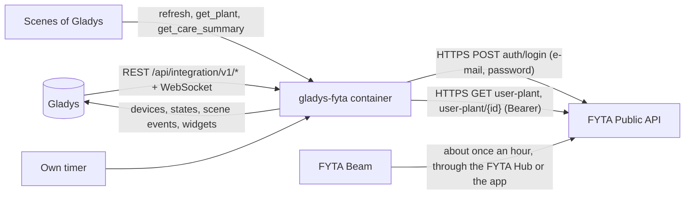
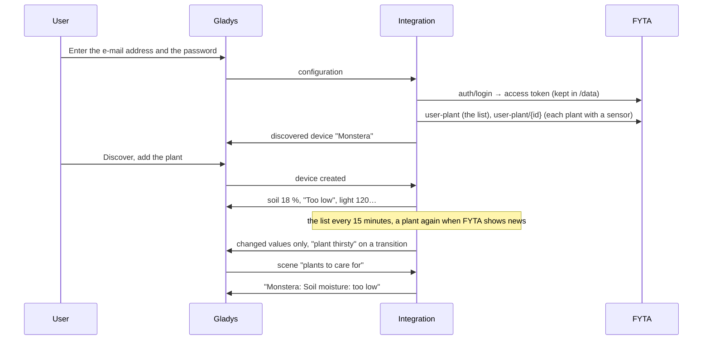
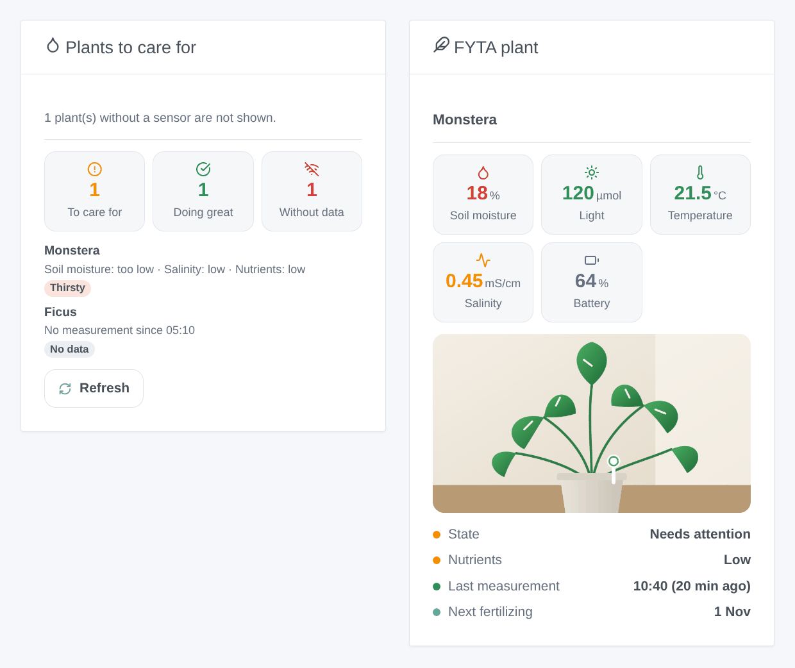

# Gladys FYTA

**English** · [Français](README.fr.md) · [Deutsch](README.de.md) · [Español](README.es.md)

[](LICENSE)
[](https://github.com/William-De71/gladys-fyta/releases)
[](https://github.com/William-De71/gladys-fyta/actions/workflows/release.yml)
[](https://gladysassistant.com)


[Gladys Assistant](https://gladysassistant.com) external integration for **FYTA Beam** plant sensors, through the official [FYTA Public API](https://fyta-io.notion.site/FYTA-Public-API-d2f4c30306f74504924c9a40402a3afd) and the e-mail address and password of your FYTA account. It shows the soil moisture, light, temperature and battery of each plant in Gladys with the state FYTA gives them, and fires scenes when a plant is thirsty, a measure leaves or comes back to its range, a sensor goes silent or it is time to fertilize — read only.

User documentation: [English](docs/en.md) · [Français](docs/fr.md) · [Deutsch](docs/de.md) · [Español](docs/es.md).

Not affiliated with FYTA. **Not tested with a real FYTA account yet**: the requests and the fields follow the official documentation and the fields Home Assistant reads; the answers to an unknown account and to a wrong token were checked live.

## Features

- Every **plant with a FYTA Beam** of the account, found by itself; the list read in **one request** every 15 minutes by default, the details of a plant only when FYTA shows something new for it.
- **One device per plant**: soil moisture, light (µmol/m²/s), temperature, sensor battery and its low flag, the pH when FYTA gives one, and six states as FYTA gives them (plant, soil moisture, light, temperature, salinity, nutrients: too low, low, perfect, high, too high).
- **9 scene triggers** (plant needs attention, plant thirsty, measure out of range, measure back in range, sensor battery low, sensor silent, sensor back, fertilizing due, access refused), **3 scene actions** (refresh now, values of a plant, plants to care for) and **2 dashboard widgets** (plants to care for, one plant with its picture).
- **Read only**: a login, then `GET` requests only; nothing is ever changed in the FYTA account.
- The access token of FYTA is kept in `/data` until it expires (no login at every restart); the password is never written there.
- Four languages everywhere: English, French, German, Spanish.

## How it works




From the account to a scene:



### Transport

`transports: ["cloud"]`: everything goes through the FYTA cloud (`web.fyta.de`), which receives the measurements of the Beams through the FYTA Hub or the FYTA app. **The e-mail address and the password leave your network** (to FYTA only, to log in); the measurements of your plants come from FYTA. `/data` keeps the access token and its expiry, a fingerprint of the e-mail address, the plants and their last details, and what the triggers know — never the password.

## Devices and features

| Device                    | Features (category / type)                                                                                                                                                                                                                                                                                                                                                                                                 |
| ------------------------- | -------------------------------------------------------------------------------------------------------------------------------------------------------------------------------------------------------------------------------------------------------------------------------------------------------------------------------------------------------------------------------------------------------------------------- |
| One per plant with a Beam | Soil moisture (`soil-moisture-sensor` / `decimal`, %), light (`light-sensor` / `decimal`, µmol/m²/s, no unit in Gladys), temperature (`temperature-sensor` / `decimal`, °C), pH (`ph-sensor` / `decimal`, when FYTA gives one), sensor battery (`battery` / `integer`, %), sensor battery low (`battery-low` / `binary`), states of the plant, soil moisture, light, temperature, salinity and nutrients (`text` / `text`) |

- FYTA measures the light as a photon flux (PPFD, µmol/m²/s), not in lux: the core has no unit for it, so the feature has none and its name says it.
- The salinity (electrical conductivity of the soil, the fertilizer, mS/cm) has no category in the core: its state is a feature, its value is shown by the widget and given to the scenes.
- The states are texts in the language of the configuration ("Too low", "Perfect"…), as FYTA rates each measure against the needs of the species.
- A plant without a sensor is not offered. External ids rest on the id of the plant in the FYTA account (`ext:fyta:plant:<id>`).
- Unchanged values of a sensor still reporting are sent again every 6 hours, so that Gladys does not show them as outdated; the values of a silent sensor are left to age.

## Scene triggers, actions and widgets



**Widgets**: Plants to care for (how many need care, are doing great, send no data; the plants to look after, the worst first, with what is wrong and, on a tap, the values and their ideal range; a Refresh button) and FYTA plant (the picture from the FYTA app, soil moisture, light, temperature, salinity and battery colored by their state, the state of the plant and of its nutrients, the last measurement, the next fertilizing date).

**Triggers** (one event per transition, never at the first reading, never as the result of an action):

- **plant needs attention**: FYTA's state of the plant goes from "doing great" to "needs attention"; variables: what is wrong, how many measures;
- **plant thirsty**: the soil moisture enters the low or too low range; variables: the moisture, the level, the lowest good moisture;
- **measure out of range** / **back in range**: soil moisture, light, temperature, salinity or nutrients changes level (filters: measures, levels); variables: the value, its unit, the ideal range;
- **sensor battery low**: FYTA flags the battery;
- **sensor silent** / **sensor back**: no measurement for the delay of the configuration (3 h by default), then measurements again, with how long it lasted;
- **fertilizing due**: the date FYTA planned, at 9:00;
- **access refused**: FYTA refuses the e-mail address, the password or the account — once per refusal.

Filter: the plant. The values (soil moisture, temperature) are device features: "soil moisture under 30 %" is a device trigger of Gladys.

**Actions**:

- **refresh now**: reads every plant now (once a minute at most); the triggers follow at the next round of the timer, never from the action.
- **values of a plant**: soil moisture, light, temperature, salinity, battery, their states, the hours since the last measurement and a sentence, from the last reading (no request).
- **plants to care for**: how many plants need care, how many sensors are silent, and a sentence listing them — for a daily message.

Not done, on purpose: no write (the public API has none), no history chart (the measurements endpoint exists, but the device features already keep the history in Gladys), no "watering done" button (FYTA has no such endpoint).

Examples:

- When **FYTA: plant thirsty** → send "{{triggerEvent.data.plant_name}} is thirsty ({{triggerEvent.data.moisture}} %)".
- Every day at 8:00 → **FYTA: plants to care for**; if the number is above 0 → send its summary.
- When **FYTA: sensor silent** → send "No news from {{triggerEvent.data.plant_name}} for {{triggerEvent.data.hours_without_data}} h".

## Requirements

- Gladys Assistant **5.3.0** or later (widgets and scenes of integrations, catalog keywords of Gladys 5.3): older instances cannot install the integration.
- A FYTA account with at least one plant linked to a **FYTA Beam**, whose measurements reach the FYTA cloud through a **FYTA Hub** (or the FYTA app when the phone is near).
- The internet: the integration talks to `web.fyta.de` only (and to the host of the plant pictures FYTA gives, without the token unless it is on `fyta.de`).

### The pace of the API

FYTA documents no quota. The integration stays light: one request at a time, one second apart at least; the list of the plants every 15 minutes by default (one request for the whole account), the details of a plant only when the list shows a new measurement, state or battery flag for it, or every 6 hours; one login every 60 days. After a 429 every request waits for its Retry-After (30 seconds to one hour). A Beam reports about once an hour: reading more often would bring nothing.

## Installation

- **From the store**: Integrations → FYTA → Install.
- **From the repository URL**: Integrations → external integration → `https://github.com/William-De71/gladys-fyta`.
- **Developer mode**: run `npm start` with the variables given by Gladys (see Development).

## Configuration

| Field or button                  | Default   | Meaning                                                                                 |
| -------------------------------- | --------- | --------------------------------------------------------------------------------------- |
| E-mail address                   | —         | Required: the e-mail of the FYTA account                                                |
| Password                         | —         | Required, a secret: never shown again, never logged, never written to `/data`           |
| Reading of the plants            | 15 min    | 10, 15, 30 or 60 min: one request for the list of the account                           |
| Sensor without data after        | 3 h       | 2, 3, 6, 12 or 24 h without a new measurement                                           |
| Language of the texts            | automatic | Feature names, states, scene texts and errors                                           |
| Test the connection / Diagnostic | —         | A login and the plants with a sensor; the state in the logs, without password nor token |

## Usage

1. In Gladys (Integrations → FYTA → Configuration): enter the e-mail address and the password of the FYTA app; press **Test the connection**.
2. **Discover**, then add your plants as devices.
3. Add the widgets to a dashboard.
4. Build scenes with the features, the triggers and the actions.

## Development

```bash
npm install
npm test                       # node --test, a fake FYTA (in-memory fetch), never the network
npm run lint                   # ESLint
npm run format:check           # Prettier
npx github:GladysAssistant/integration-store . --skip-image-check
scripts/build-cover.sh         # cover.jpg from docs/assets/cover.svg
docs/illustrations/render.sh   # docs/assets/widgets.<lang>.png
```

Locally, the SDK reads `GLADYS_HOST_API_URL`, `GLADYS_INTEGRATION_TOKEN` and `GLADYS_INTEGRATION_SELECTOR` (given by Gladys in developer mode), and the integration reads `TZ`. `DEBUG=gladys-integration-sdk` shows the SDK logs.

The tests cover the HTTP client (the login, 404 / 401 at the login, 403 and 500 on a token, one new login, 429 and Retry-After, one request at a time, the pictures), the parsers (the examples of the official documentation, kept unchanged in `test/fixtures/fyta-doc.json`, and a made-up account built on their shapes), the triggers (transitions, silence, fertilizing), the devices (the fields the Discovery screen requires, the category / type pairs of the core), the widgets (`validateWidgetContent`), the manifest, the four languages, the release script, and the whole integration against the fake Gladys of the SDK and a fake FYTA. `test/structure.test.js` freezes every key users store.

## Release process


Every merge on `main` runs the CI, then computes the version from the [Conventional Commits](https://www.conventionalcommits.org/) since the last tag: `feat` → minor, `fix` / `perf` → patch, `!` or `BREAKING CHANGE` → major (a minor below 1.0.0); `docs`, `chore`, `ci`, `test`, `style`, `refactor`, `build` alone publish nothing. The changelog section is generated, the tag pushed, the multi-architecture image built, then `main` receives the release commit, the GitHub Release is created and a last job checks the public image, the store validator and the topic.

- The pull request title becomes the squash commit, then the changelog line: write it in English, for the user (`pr-title.yml` checks it). Never edit `CHANGELOG.md` by hand.
- 1.0.0 is a decision: Actions → Release → Run workflow with `release-as: 1.0.0`. `dry-run` shows the version and the notes without publishing.
- **Protected branch**: the release pushes its commit to `main` with `GITHUB_TOKEN`. The `protect-main` ruleset (no deletion, no force-push) lets it through; a stricter rule (pull request required, status checks) would need GitHub Actions in its bypass list, or a GitHub App.
- After the first release, make the `ghcr.io` package public (Package settings → Change visibility), or Gladys cannot pull it.

## Troubleshooting

See [docs/en.md](docs/en.md#troubleshooting). Report issues with the versions of Gladys and of the integration, how the Beam reports (FYTA Hub or app), the message of **Test the connection** and the result of **Diagnostic** (in the logs of the integration). Never paste your password.

## Contributing

Issues and pull requests are welcome. Run `npm run format:check && npm run lint && npm test` before opening a pull request, and keep every external id and stored key unchanged (see [CLAUDE.md](CLAUDE.md)).

## Security

See [SECURITY.md](SECURITY.md): report vulnerabilities privately. The password is a `secret` field: never logged, never written to `/data`, sent to `web.fyta.de` only, to log in. The access token FYTA gives is kept in `/data/fyta.json` (mode 0600) until it expires, never logged, and sent to `fyta.de` hosts only.

## Screenshots to come

The images above are illustrations, not screenshots. Real screenshots will go in `docs/assets/screenshots/` (PNG, 1280 × 800): `configuration.png`, `discovery.png` (the plants offered), `device.png` (a plant with its features), `scene-thirsty.png` (a scene on the "plant thirsty" trigger), `dashboard.png` (the two widgets with real plants and pictures).

## License

[Apache License 2.0](LICENSE) — see also [NOTICE](NOTICE). FYTA and FYTA Beam are trademarks of their owner. Thanks to the Gladys documentation and SDK, to FYTA for its public API documentation, and to the authors of the Home Assistant "FYTA" integration and its fyta_cli library.
